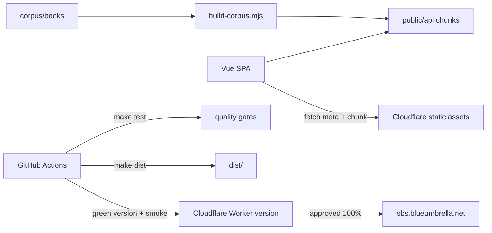

# TECHSPEC — Side by Side

## Component breakdown

| Component | Responsibility | Provides / consumes |
| --- | --- | --- |
| `corpus/books/` | Canonical Russian JSONL: one line per source segment with translation; `index.jsonl` per language | Consumed by the builder |
| `scripts/build-corpus.mjs` | Validate and split each book into `public/api/books/<lang>/<author>/<title>/meta.json` + 500-segment chunks; reject blank-source segments | Reads corpus; writes generated assets |
| `scripts/check-corpus.mjs` | Index/file parity, parse checks, source/translation completeness, Vocab Level guardrails (CEFR or Unrated; empty below 250 words), zero-segment books | CI gate |
| `src/pages/Index` | Index route, filters, pagination | Reads `index.jsonl`; renders cards |
| `src/pages/Book` | Book route; maps a URL page to a chunk, resolves the bookmark, records reveals and position | Uses `useBookReader` and `useBookshelf` |
| `src/components/Book` | Reader presentation, chunk math, JSONL fetching, the bookmark notice | Props/events; no routing |
| `src/components/Bookshelf` | Bookmark store: pure position maths, versioned localStorage, reactive store | Consumes `meta.json` counts; provides entries to pages |
| `scripts/smoke.mjs` | Post-deploy end-to-end check | Reads the live site |
| `.github/workflows` | Gates, green staging, production approval, promotion, tags | GitHub Actions |
| `wrangler.jsonc` | Cloudflare Worker name, assets directory, custom domain | Deployment config |

## Object model

| Object | Fields | Notes |
| --- | --- | --- |
| IndexEntry | `lang`, `author`, `title`, stats, `translated` | One line of `index.jsonl`; `Vocab Level` is a CEFR string or empty (Unrated), and is empty below 250 words |
| Segment | `title`, `author`, `start`, `end`, `text`, `translation` | One JSONL line |
| BookMeta | `segments`, `chunkSize`, `chunkCount` | Generated per book |
| Chunk | ordered segments | 500 segments by default |
| Book | `lang`, `author`, `title`, `segments` | A value object on a bookshelf entry; identity plus its length. The corpus has no ids, so identity is its address |
| BookshelfEntry | `book`, `position`, `revealedThrough`, `updatedAt`, `finishedAt?`, `removedAt?` | The reader's relationship to one book. Segment indices, never pages; a single high-water mark for reveals; `removedAt` is a tombstone |
| Bookshelf | `version`, `entries[]` | Versioned local data; one entry per book, ordered by recency on read |
| User (planned) | provider subject, optional profile | Google OAuth; minimal data |

## Architecture

Layers: `pages` → `components`/composables → data helpers → generated
corpus. `src/components` must not import `src/pages`; `scripts/` must not
import `src/`. `test/test.architecture.ts` enforces these boundaries.

## Technology choices

- **Vue 3 + TypeScript + Vite** — the existing app; a full framework would
  add server/runtime weight the static reader does not need.
- **Cloudflare Workers Static Assets** — one assets-only Worker, free
  unlimited static requests, atomic versions, custom domain, rollback.
  Pages was the alternative; Workers is the current platform and gives the
  approval/version flow directly. R2 is the scale-out path for >20k files.
- **Chunked JSONL** — 500 segments/chunk; worst first page ~51 KB gzipped.
  Byte-range requests were considered; chunk files cache more predictably.
- **Vitest + Testing Library + MSW** — component and reader tests without a
  live backend.
- **Versioned `localStorage` behind a store interface** — no server code in the
  reading path (cost, longevity). A `BookshelfStore` interface with one local
  implementation keeps the UI off storage and leaves room for an API-backed
  store at sign-in. IndexedDB was considered and rejected: it would keep `Date`
  objects natively but costs an async store for a few dozen small records.
- **GitHub Actions + Cloudflare versions** — green candidate, smoke, human
  approval, atomic promotion, automatic rollback.

## Spikes required

- **Bookshelf local persistence** (before #138): proved — the bookmark and the
  revealed mark survive reload, a page-size change and two open tabs, with no
  backend.
- **Google OAuth + D1 sync** (before #139): prove the authorization-code flow,
  secure cookie handling, anonymous-to-account merge and account deletion on
  a Worker with assets. This turns the assets-only Worker into an API Worker;
  confirm free-tier limits are acceptable.

## Strategic decisions

- **No server code in the reading path** (PRD cost/longevity): all content is
  prebuilt; a Worker script is added only for accounts/sync.
- **Every card has source text**; a blank card is a data defect and fails
  `check-corpus` and the builder (PRD user requirement: readable passages).
- **Semver releases are explicit and reviewed**: `make release VERSION=x.y.z`
  opens a version-bump PR; merging it triggers the gated pipeline. CI tags
  `v<version>` once and moves `production` after a successful smoke
  (PRD longevity/rollback).
- **Green before blue**: production traffic changes only after the candidate
  version passes smoke and a required `production` approval (PRD monitoring
  and rollback).
- **Reading position is a segment index, not a page** (PRD resume requirement):
  a page is a view over the segments, so the stored bookmark survives a change
  to the page size. Reveals are one high-water mark per book, and the reader's
  own reveals are the only thing that moves it.
- **The bookmark moves only by reading** (PRD resume and look-back
  requirements): navigating back or jumping elsewhere is browsing, which never
  writes. This is why a reader cannot lose their place by checking an earlier
  page.
- **Entries are tombstones, never deletions** (PRD control requirement): a
  removed book keeps its entry with `removedAt`, so undo restores it exactly
  and a second device cannot resurrect it once sync exists.
- **Anonymous use must keep working forever** (PRD access constraint): the
  bookshelf is local-first, and a future account layer merges into it rather
  than replacing it.

## Data and failure flow

1. Build validates corpus and writes chunks.
2. Index fetches `index.jsonl`; a book fetches `meta.json` + one chunk.
3. Missing chunk/meta shows an error; SPA fallback HTML is detected by
   content type.
4. The bookshelf is read from `localStorage` before the first render. Corrupt
   or unavailable storage yields an empty bookshelf, never an error; a newer
   schema version is left untouched. Writes are debounced, flushed on
   `pagehide`, and mirrored across tabs.
5. Deployment uploads a version, smokes its URL, waits for approval, promotes
   at 100%, smokes production, and rolls back on failure.
