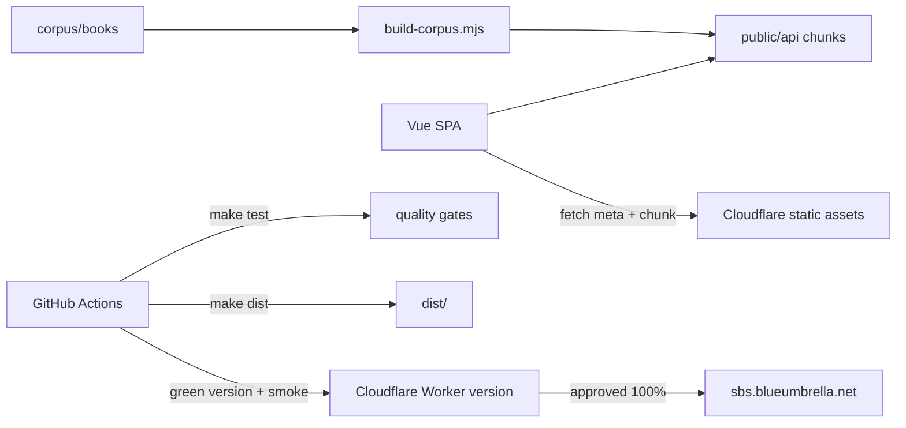

# TECHSPEC — Side by Side

## Component breakdown

| Component | Responsibility | Provides / consumes |
| --- | --- | --- |
| `corpus/books/` | Canonical Russian JSONL: one line per source segment with translation; `index.jsonl` per language | Consumed by the builder |
| `scripts/build-corpus.mjs` | Validate and split each book into `public/api/books/<lang>/<author>/<title>/meta.json` + 500-segment chunks; reject blank-source segments | Reads corpus; writes generated assets |
| `scripts/check-corpus.mjs` | Index/file parity, parse checks, source/translation completeness, CEFR/tag guardrails | CI gate |
| `src/pages/Index` | Index route, filters, pagination | Reads `index.jsonl`; renders cards |
| `src/pages/Book` | Book route; maps URL page to a chunk | Uses `useBookReader` |
| `src/components/Book` | Reader presentation, chunk math, JSONL fetching | Props/events; no routing |
| `scripts/smoke.mjs` | Post-deploy end-to-end check | Reads the live site |
| `.github/workflows` | Gates, green staging, production approval, promotion, tags | GitHub Actions |
| `wrangler.jsonc` | Cloudflare Worker name, assets directory, custom domain | Deployment config |

## Object model

| Object | Fields | Notes |
| --- | --- | --- |
| Book | `lang`, `author`, `title`, stats, `translated` | Index entry |
| Segment | `title`, `author`, `start`, `end`, `text`, `translation` | One JSONL line |
| BookMeta | `segments`, `chunkSize`, `chunkCount` | Generated per book |
| Chunk | ordered segments | 500 segments by default |
| BookshelfEntry (planned) | book identity, `page`, `start`, `updatedAt` | Local first; account-backed later |
| User (planned) | provider subject, optional profile | Google OAuth; minimal data |

## Architecture

Layers: `pages` → `components`/composables → data helpers → generated
corpus. `src/components` must not import `src/pages`; `scripts/` must not
import `src/`. `test/test.architecture.ts` enforces these boundaries.

## Technology choices

- **Vue 3 + TypeScript + Vite** — the existing app; a full framework would
  add server/runtime weight the static reader does not need.
- **Cloudflare Workers Static Assets** — one assets-only Worker, free
  unlimited static requests, atomic versions, custom domain, rollback.
  Pages was the alternative; Workers is the current platform and gives the
  approval/version flow directly. R2 is the scale-out path for >20k files.
- **Chunked JSONL** — 500 segments/chunk; worst first page ~51 KB gzipped.
  Byte-range requests were considered; chunk files cache more predictably.
- **Vitest + Testing Library + MSW** — component and reader tests without a
  live backend.
- **GitHub Actions + Cloudflare versions** — green candidate, smoke, human
  approval, atomic promotion, automatic rollback.

## Spikes required

- **Google OAuth + D1 sync** (before #139): prove the authorization-code flow,
  secure cookie handling, anonymous-to-account merge and account deletion on
  a Worker with assets. This turns the assets-only Worker into an API Worker;
  confirm free-tier limits are acceptable.
- **Bookshelf local persistence** (before #138): prove page/segment progress
  survives reload and a chunk-size change; no backend.

## Strategic decisions

- **No server code in the reading path** (PRD cost/longevity): all content is
  prebuilt; a Worker script is added only for accounts/sync.
- **Every card has source text**; a blank card is a data defect and fails
  `check-corpus` and the builder (PRD user requirement: readable passages).
- **Semver releases are explicit**: `release.yml` takes a version; CI tags
  `v<version>` once and moves `production` after a successful smoke
  (PRD longevity/rollback).
- **Green before blue**: production traffic changes only after the candidate
  version passes smoke and a required `production` approval (PRD monitoring
  and rollback).

## Data and failure flow

1. Build validates corpus and writes chunks.
2. Index fetches `index.jsonl`; a book fetches `meta.json` + one chunk.
3. Missing chunk/meta shows an error; SPA fallback HTML is detected by
   content type.
4. Deployment uploads a version, smokes its URL, waits for approval, promotes
   at 100%, smokes production, and rolls back on failure.
